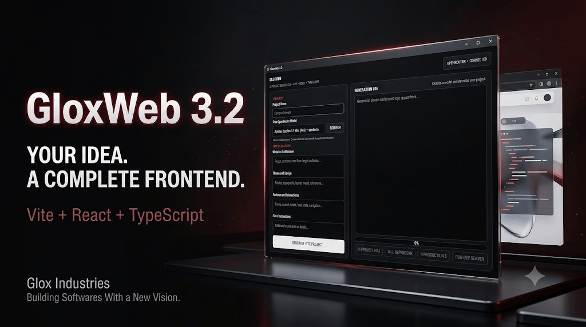

  

  
  
  
  

# GloxWeb

### AI-Powered Frontend Builder by Glox Industries

**Build beautiful, functional website frontends in 1–2 hours with the power of AI.**

GloxWeb is an AI-powered frontend builder designed to simplify website development. It uses free models available through **OpenRouter** to generate complete website frontends from structured instructions, helping users turn their ideas into polished web interfaces without spending hours writing everything from scratch.

The goal is simple: create websites that look and feel like they were thoughtfully designed by a human, rather than having the generic appearance often associated with AI-generated websites.

---

## ✨ Features

- **AI-Powered Generation:** Generate complete frontend projects using OpenRouter's free AI models.
- **Four-Section Prompt System:** Organize your website requirements into four dedicated sections.
- **Custom Project Naming:** Give every generation a project name.
- **Design Flexibility:** Create modern, minimal, professional, creative, or completely custom interfaces.
- **Full Frontend Generation:** Generate entire frontend structures rather than isolated UI components.
- **Fast Development:** Build a presentable website frontend in approximately 1–2 hours, depending on complexity.
- **Model Flexibility:** Choose from different OpenRouter-supported models depending on your requirements.
- **Accessible AI Development:** Make frontend development more approachable, even for users who aren't experienced developers.

---

## 🛠️ How It Works

GloxWeb uses four main instruction sections to understand and generate your website.

| Section | Purpose |
|---|---|
| **Project Name** | Defines the name and identity of your website project. |
| **Website Architecture** | Defines the website structure, pages, sections, and overall layout. |
| **Theme and Design** | Defines colors, typography, visual style, spacing, and UI direction. |
| **Features and Interaction** | Defines functionality, components, animations, and user interactions. |
| **Extra Instructions** | Provides additional requirements, restrictions, and implementation guidelines. |

By combining these instructions, GloxWeb generates a frontend that follows your intended structure and design rather than relying on generic website templates.

---

## 🤖 Recommended AI Models

GloxWeb uses OpenRouter to access free AI models. Model selection can significantly affect generation quality, speed, and instruction-following capabilities.

The following models are recommended:

| Model | Recommended For |
|---|---|
| **NVIDIA Nemotron Ultra 3** | Complex website architectures, detailed instructions, and advanced frontend generation. |
| **NVIDIA Nemotron Super 3** | Balanced website generation and general frontend development. |
| **NVIDIA Nemotron Omni 3** | Requirements where its particular multimodal capabilities are useful. |

*Model availability and free-tier limits depend on OpenRouter and may change over time.*

**Tip:** Choose your model based on the complexity of your website. A more capable model may take longer to begin generating, but the additional wait can be worthwhile.

---

## ⚡ Performance and Expectations

GloxWeb is designed for rapid frontend development.

- A reasonably complete website frontend can often be generated within **1–2 hours**.
- Initial generation may take some time, particularly with more capable models.
- Occasional bugs, incomplete components, or unexpected UI behaviour may occur.
- Most generations run successfully, but AI-generated code should always be reviewed and tested.
- More detailed and structured instructions generally produce better results.

GloxWeb is particularly useful when you want a polished, professional-looking website without the generic appearance commonly associated with AI-generated interfaces.

---

## 🎯 Intended Use Cases

GloxWeb is suitable for:

- Personal portfolios
- Business websites
- Landing pages
- SaaS dashboards
- Educational websites
- Student projects
- Product showcase websites
- Creative web interfaces
- Rapid frontend prototyping

Whether you're experimenting with a design idea or building a complete frontend for a project, GloxWeb helps reduce the time between having an idea and seeing it come to life.

---

## ⚠️ Usage Guidelines

GloxWeb is intended strictly for **personal use, learning, teaching, and educational purposes**.

- Do not claim GloxWeb itself as your own independently developed project.
- Do not redistribute, resell, or present the original project as your own creation.
- Give appropriate credit whenever showcasing or referring to GloxWeb.
- Respect the work and contributions of its original creator.

Use it to learn, experiment, teach, and build. Give credit where it is due.

---

## 👨‍💻 Credits

**AvgLucer | Gaurav W**

**CEO at Glox Industries & Founder**

Created with the vision of making AI-assisted frontend development more accessible, practical, and efficient.

---

### GloxWeb
**Your ideas. Your design. AI-powered development.**

*Built by Glox Industries.*
